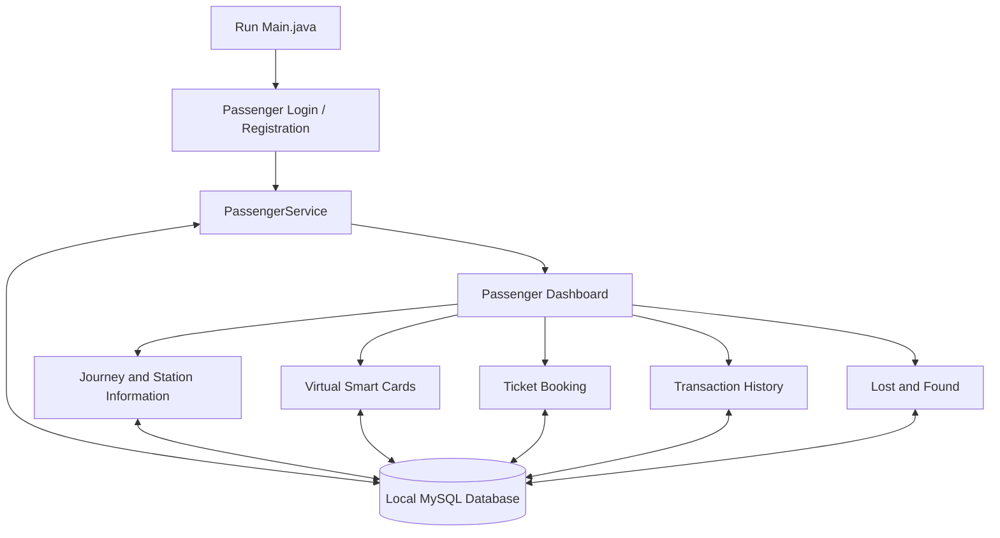

# Metro Management and Smart Card System

**A Java Swing desktop application for metro passenger services, journey planning, virtual smart cards, ticket booking, and metro information management.**

The **Metro Management and Smart Card System** brings several metro-related services together in a single graphical application. It provides passenger registration and login, a dashboard for navigating services, station and route information, virtual smart card management, ticket booking, transaction history, and lost-and-found reporting. The application uses **Java Swing** for its desktop interface, **JDBC** for data access, and **MySQL** to store operational records.

> **Project type:** Java desktop application — not a website or a publicly hosted server. The source code and SQL database dump can be shared on GitHub; MySQL must be imported and run locally for the application to work.

## Table of Contents

- [Project Overview](#project-overview)
- [Objectives](#objectives)
- [Features](#features)
- [Technology Stack](#technology-stack)
- [Project Structure](#project-structure)
- [How the Application Works](#how-the-application-works)
- [Database Overview](#database-overview)
- [Requirements](#requirements)
- [Installation and Setup](#installation-and-setup)
- [How to Use](#how-to-use)
- [Implementation Notes](#implementation-notes)
- [Security and Limitations](#security-and-limitations)
- [Future Enhancements](#future-enhancements)

## Project Overview

Metro passengers often need to access different services for journey information, cards, tickets, and support. This project demonstrates how these services can be organized into a unified desktop application backed by a relational database.

The main application entry point is `com.metromanagement.main.Main`, which starts the passenger login screen (`LoginFrame`). After successful authentication, the passenger dashboard provides access to the project's various service screens.

## Objectives

- Build a user-friendly desktop interface for common metro services.
- Allow passengers to register and log in with stored account information.
- Display metro stations and plan routes between selected stations.
- Manage virtual smart cards, balances, and recharge records.
- Provide ticket-booking and ticket-cancellation functionality.
- Display card transaction histories and search/filter information.
- Record and view lost-and-found reports.
- Demonstrate Java OOP, collections, exception handling, Swing, JDBC, SQL, and multi-screen application design.

## Features

### 1. Passenger Registration and Login

- Registration form for passenger details such as name, email, phone number, and password.
- Login using email address or phone number.
- Password storage uses salted **PBKDF2-HMAC-SHA256** hashes in `PassengerService` rather than storing new registration passwords as plain text.
- Login attempts are recorded through the `login_history` database table when the database is available.
- Passenger dashboard and a profile editing interface.

### 2. Passenger Dashboard

The main dashboard provides navigation to:

- Dashboard and passenger profile
- Smart Cards
- Plan Journey
- Station Details
- Metro Map
- Tickets
- Transaction History
- Lost & Found

### 3. Journey Planning and Route Information

- Select source and destination metro stations.
- Load station and metro-line information from MySQL.
- Construct a route graph from stations and ordered line connections.
- Search for alternative routes and show interchange information.
- Display route details with estimated fare and journey-related information.

The route planning is an application-side estimate based on the stored metro network; it is not a real-time transit tracking service.

### 4. Metro Stations and Map

- Browse metro lines and their associated stations.
- Display station details from the database.
- View a supplied metro-map image with zoom controls.

### 5. Virtual Smart Card Management

- Issue a virtual smart card with a generated card number.
- View card numbers, balances, and statuses.
- Recharge cards with supported amounts: **₹100, ₹200, ₹500, or ₹1,000**.
- Activate/deactivate cards from the management interface.
- Generate a QR code containing the virtual card identifier using **ZXing**.
- View recent card transactions.

The QR code is generated inside this application; it is **not** an integration with an actual metro gate or payment network.

### 6. Ticket Booking and Cancellation

- Select a smart card, source station, and destination station.
- Calculate an estimated ticket fare in the desktop interface.
- Create a ticket record with a generated ticket number.
- View and search previously booked tickets.
- Cancel eligible tickets and update their booking status.

Ticket booking is a project-level database workflow, not a connection to an official metro ticketing system or payment gateway.

### 7. Transaction History

- View recorded smart card transactions.
- Filter by card number, transaction type, and date range.
- View transaction summary information, including recharge totals.

### 8. Lost and Found

- Submit a lost or found item report with item, station, contact, and date/time information.
- Store reports in MySQL.
- View lists of previously reported lost or found items.
- Access informational guidance within the interface.

### 9. Additional Administration / Staff Screens

The codebase also includes `AdminLogin`, `AdminDashboard`, `PassengerManagement`, and `StaffDashboard` interfaces. These are separate from the main passenger startup flow. Some are **demonstration or partially implemented modules**: for example, `PassengerManagement` uses in-memory `MetroData` collections, and several staff dashboard sections are placeholders. They should not be treated as fully integrated administrative services.

## Technology Stack

| Component | Technology |
| --- | --- |
| Programming language | Java |
| Desktop interface | Java Swing and AWT |
| IDE | Eclipse IDE |
| Database | MySQL |
| Database connectivity | JDBC / MySQL Connector/J |
| QR code generation | ZXing Core + ZXing Java SE |
| Data structures | Java collections, including `ArrayList` and `HashMap` |
| Authentication | PBKDF2-HMAC-SHA256 for passenger password hashes |
| Version control | Git and GitHub |

**Project configuration:** The supplied Eclipse `.classpath` targets **JavaSE-25** and references MySQL Connector/J and ZXing Core/Java SE **3.5.3** JARs using machine-specific local paths. Those JAR files are **not bundled** in the provided project ZIP and must be configured on another computer.

## Project Structure

```text
MetroManagementAndSmartCardSystem/
├── src/
│   ├── module-info.java
│   └── com/metromanagement/
│       ├── main/
│       │   ├── Main.java                 # Standard application entry point
│       │   ├── PassengerLogin.java
│       │   └── PassengerDashboard.java
│       ├── database/
│       │   └── DBConnection.java         # MySQL JDBC connection
│       ├── gui/
│       │   ├── LoginFrame.java
│       │   ├── RegisterFrame.java
│       │   ├── PassengerDashboard.java
│       │   ├── JourneyFrame.java
│       │   ├── StationDetailsPanel.java
│       │   ├── StationFrame.java
│       │   ├── MetroMapFrame.java
│       │   ├── SmartCardFrame.java
│       │   ├── TicketFrame.java
│       │   ├── TransactionHistoryFrame.java
│       │   ├── LostFoundFrame.java
│       │   ├── AdminLogin.java
│       │   ├── AdminDashboard.java
│       │   ├── PassengerManagement.java
│       │   ├── StaffDashboard.java
│       │   ├── delhi_metro_map.jpg
│       │   └── metro_background.png
│       ├── service/
│       │   ├── PassengerService.java
│       │   └── SmartCardService.java
│       ├── model/                       # Passenger, Journey, Station, etc.
│       ├── collection/
│       │   └── MetroData.java
│       └── exception/
│           └── InsufficientBalanceException.java
├── .classpath
├── .project
├── .settings/
└── README.md
```

> The diagram focuses on source and project configuration files; the downloaded ZIP also contains a `bin/` folder with generated `.class` files. A SQL dump **was not included in the project ZIP reviewed for this README**; add your separate sanitized dump to the repository if you want others to recreate the database.

## How the Application Works



**Application layers:**

1. **GUI:** Swing windows, forms, tables, and navigation panels.
2. **Service:** Business logic for passenger accounts and virtual smart cards.
3. **Model:** Java objects representing passengers, stations, journeys, and cards.
4. **Database:** MySQL data read and updated through JDBC and SQL statements.

## Database Overview

The Java source references the following MySQL tables:

| Table | Use in the application |
| --- | --- |
| `passengers` | Passenger account and profile details |
| `login_history` | Recorded login attempts |
| `metro_stations` | Metro station information |
| `metro_lines` | Metro line information |
| `metro_line_stations` | Ordered station-to-line relationships used for route planning |
| `smart_cards` | Virtual smart card information, balances, and status |
| `card_transactions` | Card issuance and recharge records |
| `tickets` | Ticket booking and cancellation records |
| `lost_found_reports` | Lost-and-found submissions |

The actual SQL dump is the authoritative source for full table definitions, keys, constraints, and any example records. This README describes table usage observed in the supplied Java source code; it does not claim to be the full database schema.

The database name currently expected by `DBConnection.java` is:

```sql
metro_management
```

## Requirements

Before running the application, install or prepare:

1. **JDK 25**, matching the project's current Eclipse configuration (or update the project to a compatible installed JDK).
2. **Eclipse IDE** with Java Development Tools.
3. **MySQL Server** running on your computer.
4. **MySQL Workbench** (recommended for importing the SQL dump).
5. **MySQL Connector/J** JDBC driver.
6. **ZXing Core 3.5.3** and **ZXing Java SE 3.5.3** JARs; include any dependencies required by the versions you use.
7. The separate `metro_management` database dump, if you want to restore the original tables and records.

## Installation and Setup

### Step 1 — Download or clone the project

Either download the repository as a ZIP from GitHub, or clone it:

```bash
git clone https://github.com/mishtigupta129-commits/Metromanagementandsmartcardsystem.git
```

### Step 2 — Import the project into Eclipse

1. Open **Eclipse IDE**.
2. Select **File → Import → General → Existing Projects into Workspace**.
3. Choose the extracted or cloned project folder containing `.project`.
4. Select **Finish**.
5. Open **Project → Properties → Java Build Path** and check the configured JRE and libraries.

### Step 3 — Fix the external JAR references

The original Eclipse project references JARs from a specific computer's `C:/Users/.../Downloads/` folder. These paths will not work automatically on a different PC.

1. Download the required MySQL Connector/J and ZXing libraries from their respective official distribution sources.
2. In Eclipse, open **Project → Properties → Java Build Path → Libraries**.
3. Remove broken library references and add the JARs from their actual local locations.
4. Confirm the required libraries are available on the appropriate module path/classpath; the project includes `module-info.java` requiring `com.google.zxing` and `com.google.zxing.javase`.
5. Apply changes and rebuild the project.

### Step 4 — Import the MySQL database

1. Start **MySQL Server**.
2. Open **MySQL Workbench** and connect to your **local** MySQL server.
3. Choose **Server → Data Import**.
4. Select **Import from Self-Contained File**.
5. Browse to your downloaded `.sql` dump.
6. If the dump does not create/select its own database, create a schema named **`metro_management`** and choose it as the target schema.
7. Click **Start Import** and wait for completion.
8. Refresh **Schemas**, select `metro_management`, and verify the imported tables.

You can also verify using SQL:

```sql
SHOW DATABASES;
USE metro_management;
SHOW TABLES;
```

> If your dump explicitly creates or selects another database name, use the name defined in your dump or adjust your local configuration. Do not import private real-user records into a public sample project.

### Step 5 — Configure the JDBC database connection

Find:

```text
src/com/metromanagement/database/DBConnection.java
```

The supplied Java file currently connects to:

```text
jdbc:mysql://localhost:3306/metro_management
```

Make sure the host, port (`3306` by default), schema name, and MySQL user are correct for your local installation. **The supplied `DBConnection.java` contains hardcoded credentials and should be changed before public use.** Prefer reading connection settings from environment variables rather than committing them to GitHub.

For example, after updating `DBConnection.java`, it can use this pattern:

```java
String url = System.getenv("METRO_DB_URL");
String user = System.getenv("METRO_DB_USER");
String password = System.getenv("METRO_DB_PASSWORD");
Connection connection = DriverManager.getConnection(url, user, password);
```

Example values to configure **locally** (not in source control):

```text
METRO_DB_URL=jdbc:mysql://localhost:3306/metro_management
METRO_DB_USER=your_local_mysql_username
METRO_DB_PASSWORD=your_local_mysql_password
```

In Eclipse, set environment variables under **Run → Run Configurations → Java Application → Environment**. The example requires modifying `DBConnection.java`; the uploaded source does **not** read these environment variables automatically.

### Step 6 — Test the MySQL connection

Run the `main` method inside:

```text
com.metromanagement.database.DBConnection
```

If configured correctly and the server is running, it prints `MySQL Connected Successfully!`.

### Step 7 — Run the application

1. In Eclipse, open `src/com/metromanagement/main/Main.java`.
2. Right-click **Main.java → Run As → Java Application**.
3. The passenger login window should open.
4. Register a passenger account, log in, and use the dashboard options.

## How to Use

A typical demonstration sequence:

1. **Register:** Create a passenger account using the registration form.
2. **Log in:** Use the registered email address or phone number and password.
3. **Explore stations:** View metro lines, stations, and the metro map.
4. **Plan a journey:** Choose two different stations and inspect route options.
5. **Manage a smart card:** Issue a virtual card, display its QR code, and recharge its balance.
6. **Book a ticket:** Select card and travel stations, then submit a booking.
7. **Check activity:** View tickets and the smart card transaction history.
8. **Report an item:** Submit a lost-or-found item record and review listed reports.

Features require the corresponding database tables and compatible sample data; an empty or incomplete database may leave some lists empty or cause SQL errors.

## Implementation Notes

- **Swing and AWT** provide the desktop views, dialogs, layout, tables, and map display.
- **JDBC `PreparedStatement`** is used in service and GUI database operations.
- **Java collections** appear in models, local data storage, and route construction.
- **Graph-based route calculation** is implemented in `JourneyFrame` using the station-line network loaded from MySQL.
- **Database transactions** are used for virtual smart card issuance and recharges so related writes can be committed or rolled back together.
- **QR code generation** uses ZXing libraries.
- **PBKDF2-HMAC-SHA256** and random salts are used for new passenger password hashes.
- Some screens are self-contained demonstrations or incomplete modules, rather than fully integrated end-to-end features.

## Security and Limitations

This is an **educational desktop application**, not a production-ready metro operations system.

- **Remove and rotate exposed credentials.** The supplied `DBConnection.java` includes a hardcoded MySQL password. If you have already pushed it to a public repository, change that password immediately. Editing the latest commit alone does not erase secrets from Git history.
- The separate `AdminLogin` example uses hardcoded demonstration credentials and should be replaced with secure authentication before any real deployment.
- The password recovery button in the passenger login interface is **not configured**.
- Some staff/admin screens are **placeholders** or use in-memory collections instead of MySQL persistence.
- The virtual card, QR code, route fare, and ticket flows are **simulations/project-level features**. They do not connect to actual DMRC payment, gates, or official live ticketing services.
- Public SQL dumps should include only **non-sensitive schema/sample records**; do not publish actual personal details, passwords, or private operational data.
- Java `.class` files in `bin/` are generated build output; maintaining source files and required resources is generally enough for version control.

## Future Enhancements

Possible extensions to the current codebase include:

- Integrating admin and staff interfaces with the main authentication and navigation flow.
- Replacing in-memory administrative functions with persistent MySQL operations.
- Adding secure password recovery and role-based access control.
- Removing local JAR dependencies by adopting Maven or Gradle.
- Adding automated tests and a reproducible build process.
- Improving ticket validation, balance deduction, and refund workflows.
- Adding more complete error handling, validation, and audit logs.
- Providing a packaged installer for easier desktop deployment.

---

**Metro Management and Smart Card System** — a Java, Swing, JDBC, and MySQL academic project demonstrating the design of a multi-feature metro service application.
